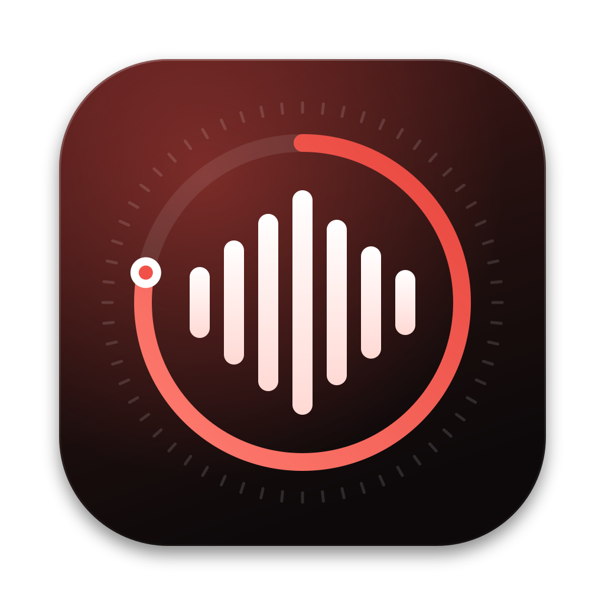

<p align="center">
  
</p>

<h1 align="center">rustune</h1>

<p align="center">
  A lightweight, native Spotify Premium player for macOS, written in Rust.
</p>

---

The official Spotify desktop app is a bundled Chromium browser. On the author's Mac it
used **~800 MB** across 8 processes. rustune draws its UI natively with
[egui](https://github.com/emilk/egui) and plays audio through Spotify's **official
Web Playback SDK**, using **~160 MB** in total while playing.

> Measured with macOS `footprint` on Apple Silicon (November 2026). Your numbers will vary
> with library size and how many covers are on screen.

## Features

- **Playback** through Spotify's official Web Playback SDK, with play/pause, skip, ±10 s,
  waveform seek bar, volume, shuffle, and repeat (off / playlist / one song)
- **Spotify Connect**: rustune shows up as a device, and the device picker moves playback
  to your phone or speakers
- **Home**: cover carousel of your playlists, mood chips, *Jump back in*, your top tracks,
  *More from {artist}*, *Albums for you*, your top artists, recently liked
- **Search** for songs, artists, albums and playlists
- **Song pages** with the full album, more by the artist, and their other albums
- **Now Playing** screen: round cover with a progress ring, blurred backdrop, heart
  (save to Liked Songs), and *Up next / Album / Artist* tabs
- Library: your playlists, Liked Songs and albums
- Signs in once with OAuth (PKCE) and remembers you
- Low idle cost: redraws only while music plays, and covers load at the size they're drawn

## How it works

```
┌──────────────────────────── rustune (one process) ────────────────────────────┐
│                                                                               │
│  egui UI (main thread)  ◄──channels──►  backend thread (tokio)                │
│        │                                  ├─ Spotify Web API (reqwest)        │
│        │ evaluate_script / IPC            ├─ OAuth PKCE sign-in, token refresh│
│        ▼                                  └─ librespot metadata (fallback)    │
│  1×1 px WKWebView (wry) running the                                           │
│  Spotify Web Playback SDK ── Apple FairPlay DRM ──► audio                     │
└───────────────────────────────────────────────────────────────────────────────┘
```

- **Audio**: the Web Playback SDK runs in a tiny WKWebView attached to the window.
  WebKit's own processes add roughly 45 MB.
- **Controls**: play/pause, skip, seek and volume go straight to the SDK. Starting a song,
  album or playlist is a Web API "play" call aimed at the SDK's device.
- **librespot** is used only to list songs in playlists you follow but don't own. In
  Development Mode the Web API hides those (see [Limitations](#limitations)). rustune does
  **not** use librespot's own player, because Spotify refuses audio keys to it on many
  accounts.

## Requirements

- macOS 11 or later. Developed on Apple Silicon. The DRM path (FairPlay in WKWebView) is
  macOS-specific.
- A **Spotify Premium** account.
- [Rust](https://rustup.rs). The toolchain is pinned to 1.95 in `rust-toolchain.toml`, and
  rustup installs it automatically.
- Your own **Spotify developer app** (free, about 2 minutes, see below).

## Setup

### 1. Create a Spotify app

Each user of a Development Mode app has to be added by hand, so use your own app rather
than the Client ID in this repo.

1. Go to the [Spotify Developer Dashboard](https://developer.spotify.com/dashboard) and click **Create app**.
2. Give it any name and description.
3. Set **Redirect URI** to exactly `http://127.0.0.1:8898/login` and click **Add**.
4. Under *APIs used*, tick **Web API** and **Web Playback SDK**, then save.
5. Copy the **Client ID**. You don't need the client secret.
6. Optional: under **User Management**, add anyone else who should be able to sign in
   (up to 5 people in Development Mode).

### 2. Use your Client ID

Replace `WEB_CLIENT_ID` in [`src/backend.rs`](src/backend.rs). If you want to run the SDK
test, also replace `CLIENT_ID` in [`examples/sdk_spike.rs`](examples/sdk_spike.rs).

A Client ID is not a secret: sign-in uses PKCE, so no client secret exists. It's fine to
commit it.

### 3. Run

```bash
cargo run --release
```

Click **Sign in with Spotify** and approve in your browser. On the very first sign-in a
second consent page may appear for the librespot playlist fallback. Later launches sign in
automatically.

## Install as a macOS app

```bash
scripts/bundle_macos.sh --install
```

This builds the release binary and assembles `rustune.app` (icon, `Info.plist`). It
ad-hoc signs the bundle and installs it to `/Applications`. Without `--install` it writes
`dist/rustune.app`. The ad-hoc signature is enough on your own Mac. To share the app, it
needs a Developer ID signature and notarization.

The icon is drawn in [`assets/icon.svg`](assets/icon.svg). Regenerate the PNGs and
`.icns` with `assets/build_icons.sh` (needs `brew install librsvg`).

## Where your data lives

| What | Where |
|---|---|
| Sign-in (refresh token, file mode `0600`) | `~/Library/Caches/rustune/web_token_v3` |
| librespot login for the playlist fallback | `~/Library/Caches/rustune/credentials.json` |

**Sign out** (bottom of the sidebar) deletes both. Nothing else is stored, and nothing is
sent anywhere except Spotify.

## Limitations

Spotify restricts apps in Development Mode (changes from February 2026):

- Search returns **at most 10 results per type**.
- The Web API lists songs only for **playlists you own or collaborate on**. For others,
  rustune reads the first 200 songs through librespot. Play still works for any playlist.
- There's **no recommendations endpoint** for new apps. Suggestions are built from your
  recently played, top tracks and artists, and artist/album search.
- Development Mode apps allow **5 users**.

Also:

- macOS only. Offline downloads, lyrics and podcasts are not supported or tested.
- The librespot fallback uses Spotify's internal APIs. It is unofficial and may break.

## Project layout

```
src/
  main.rs      window setup, embedded icon
  ui.rs        all screens (egui)
  icons.rs     vector icon set drawn with the egui painter
  sdk.rs       hidden WKWebView + Web Playback SDK bridge
  backend.rs   sign-in, commands/events, suggestions, librespot fallback
  api.rs       Spotify Web API client
examples/
  sdk_spike.rs standalone check that the SDK plays in a WKWebView
assets/        icon source (SVG), rendered PNGs, .icns, build script
scripts/       macOS .app bundling
```

## Troubleshooting

- **Build error in `librespot-core`'s build script (`vergen_lib::entries::Add`)**:
  two `vergen` versions got mixed. `Cargo.lock` pins a working one. If you update
  dependencies, run `cargo update -p vergen --precise 9.0.6`.
- **"The player is still starting"**: the SDK takes a second or two after launch to
  register its device. Try again.
- **`429 Too Many Requests`**: you're probably using a Client ID that other people share.
  Use your own app (step 1).

## Disclaimer

rustune is an unofficial, personal project. It is not affiliated with, endorsed by or
connected to Spotify AB. It requires a Spotify Premium account and uses Spotify's official
Web API and Web Playback SDK for playback. Spotify is a trademark of Spotify AB.
